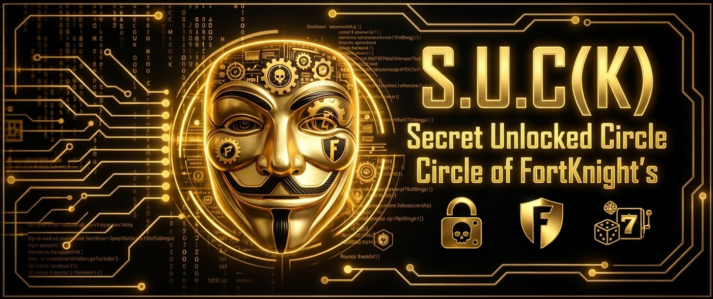
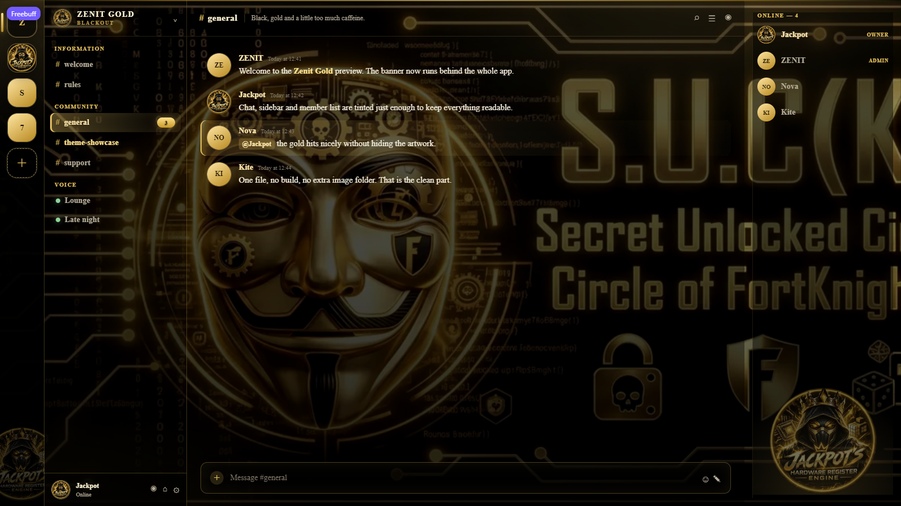

<div align="center">



# ZENIT GOLD — BLACKOUT

**A black-and-gold Discord theme with a full-bleed banner, a mascot watermark and translucent chat panels.**

[](https://github.com/JACKPOT71/zenit-gold)
[](LICENSE)
[](#betterdiscord)
[](#vencord)
[](https://github.com/JACKPOT71/zenit-gold/issues)

[Install](#install) · [Preview](#preview) · [Customize](#customize) · [Troubleshooting](#troubleshooting)

</div>

---

## Preview



<sub>Layout preview at 1600 × 900. The banner, translucent panels, gold accents and mascot watermark are the actual theme styles.</sub>

## What is Zenit Gold?

Zenit Gold is a dark Discord theme built around one full-bleed artwork. Instead of painting the app black, it keeps the banner visible behind the chat, channel list and member list, while a tinted glass layer keeps text readable.

- True black base with gold accents (`#e6c15e` / `#ffe08a`)
- Full-bleed banner behind the whole app
- Translucent chat, channel list and member list
- Mascot watermark in the server rail and member list
- Gold selected channel, mentions, badges, buttons and scrollbars
- Montserrat interface font
- One self-contained `.theme.css` file — all artwork is embedded, no image folder, no build step

## Install

### BetterDiscord

1. Download [`ZenitGold.theme.css`](https://github.com/JACKPOT71/zenit-gold/raw/main/ZenitGold.theme.css).
2. In Discord: **Settings → BetterDiscord → Themes → Open Themes Folder**.
3. Put `ZenitGold.theme.css` into `%AppData%\BetterDiscord\themes` on Windows  
   (`~/Library/Application Support/BetterDiscord/themes` on macOS).
4. Back in Discord, enable **Zenit Gold — Blackout**.
5. Restart Discord if the theme does not appear immediately.

### Vencord

#### Local file

1. Download [`ZenitGold.theme.css`](https://github.com/JACKPOT71/zenit-gold/raw/main/ZenitGold.theme.css).
2. In Discord: **Settings → Vencord → Themes → Open Themes Folder**.
3. Put the file into `%AppData%\Vencord\themes` on Windows  
   (`~/.config/Vencord/themes` on Linux).
4. Restart Discord and enable **Zenit Gold — Blackout**.

#### Online theme

1. In Discord: **Settings → Vencord → Themes → Online Themes**.
2. Paste this URL:

```text
https://raw.githubusercontent.com/JACKPOT71/zenit-gold/main/ZenitGold.theme.css
```

3. Reload Discord. Updates follow the repository automatically.

### Requirements

- Discord's **dark** theme
- BetterDiscord or Vencord
- Internet access for the Montserrat font, unless you remove the Google Fonts `@import`

## Customize

The editable values are at the top of `ZenitGold.theme.css`. Change them once and the whole theme follows.

| Variable | Default | Purpose |
| --- | --- | --- |
| `--zg-gold` | `#e6c15e` | Main accent |
| `--zg-gold-bright` | `#ffe08a` | Links and highlights |
| `--zg-gold-deep` | `#a87c1c` | Filled buttons |
| `--zg-chat-alpha` | `0.40` | Chat tint; lower shows more banner |
| `--zg-sidebar-alpha` | `0.44` | Channel-list tint |
| `--zg-members-alpha` | `0.48` | Member-list tint |
| `--zg-panel-alpha` | `0.64` | Bottom user panel |
| `--zg-input-alpha` | `0.58` | Message input |
| `--zg-bg-0` | `rgba(0,0,0,0.56)` | Secondary surfaces |
| `--zg-bg-1` | `rgba(4,4,5,0.40)` | Primary surfaces |

Example: make the artwork more present without touching the layout:

```css
:root {
  --zg-chat-alpha: 0.34;
  --zg-sidebar-alpha: 0.38;
}
```

The banner and mascot are stored as `--zg-banner` and `--zg-mascot`. To use different artwork, replace those data URIs with normal `url("https://…")` values or your own base64 data.

## Project structure

```text
zenit-gold/
├── ZenitGold.theme.css   # The complete theme
├── README.md
├── CHANGELOG.md
├── LICENSE
└── assets/
    ├── banner.jpg
    ├── mascot.png
    └── preview.png
```

## Compatibility

- Built for current Discord with BetterDiscord and Vencord.
- Discord occasionally renames internal classes. The theme uses broad class-prefix selectors and both `_` and `-` variants where needed.
- If an area is unthemed after a Discord update, open an issue with a screenshot and the name of the area.
- The theme does not modify Discord files, inject scripts or collect account data.
- Client mods are unofficial. Use them at your own risk. This project is not affiliated with Discord, BetterDiscord or Vencord.

## Troubleshooting

| Problem | Fix |
| --- | --- |
| Theme is not listed | The file must end in `.theme.css`. Restart Discord. |
| Banner is too dark or too faint | Adjust `--zg-chat-alpha` and `--zg-sidebar-alpha`. |
| Text is hard to read on bright artwork | Increase the matching alpha value. |
| Font looks different | Google Fonts is blocked or offline; the theme falls back to Discord's font. |
| Two themes fight each other | Enable only one theme at a time. |

## Changelog

See [CHANGELOG.md](CHANGELOG.md).

## License

Theme code and included artwork are released under the [MIT License](LICENSE).  
Copyright © 2026 ZENIT / Jackpot.

## Deutsch

Kurzfassung: Datei herunterladen, in den Themes-Ordner von **BetterDiscord** oder **Vencord** legen, Discord neu starten und **„Zenit Gold — Blackout“** aktivieren. Für Vencord kann alternativ die Online-URL oben eingetragen werden.

---

<div align="center">
<sub>Made with too much gold, a banner and a mascot.</sub>
</div>
